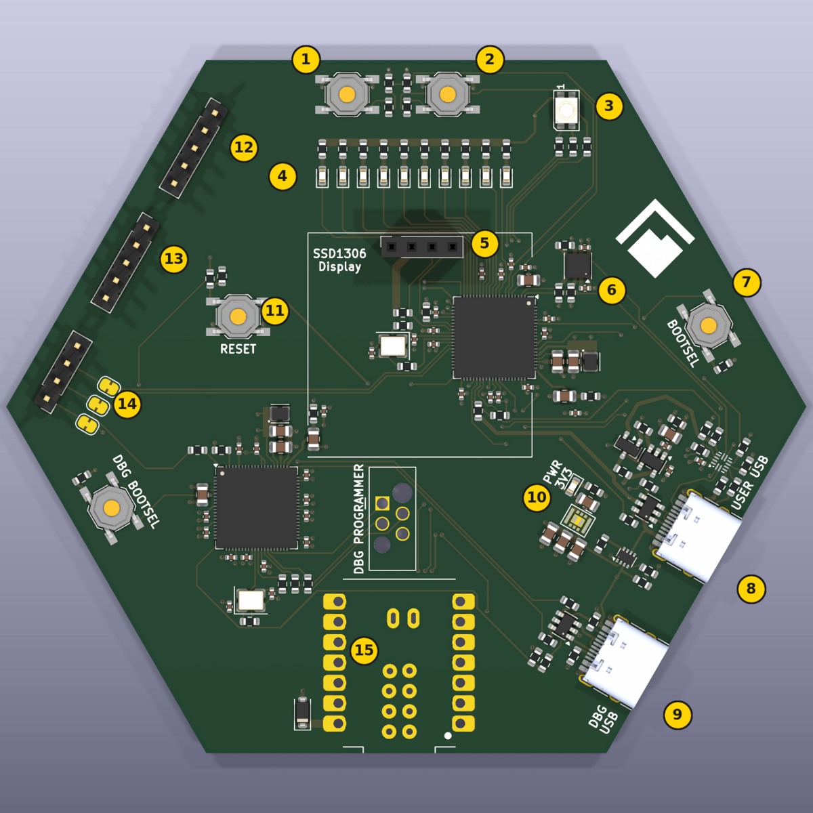

# Das ESE Rust Devboard

[Hackathon](../README.md) · [Hardware](README.md) · [PCB-Downloads](../downloads.md)

## Was ist wo?

| Nr. | Bauteil | Pins | Hinweis |
|---:|---|---|---|
| 1 | Button USER1 | GPIO8 | gedrückt = LOW |
| 2 | Button USER2 | GPIO9 | gedrückt = LOW |
| 3 | RGB-LED | R: GPIO21, G: GPIO22, B: GPIO23 | active LOW |
| 4 | LED-Leiste, 10x blau | GPIO20 (links) bis GPIO11 (rechts) | active LOW |
| 5 | SSD1306-Display | I2C1: SDA GPIO26, SCL GPIO27 | Belegung von links: GND, 3V3, SCL, SDA |
| 6 | Gassensor Bosch BME690 | I2C0: SDA GPIO4, SCL GPIO5 | Adresse `0x77` |
| 7 | BOOTSEL | | beim Reset gedrückt halten: USB-Bootloader |
| 8 | USB-C "USER USB" | USB des RP2354 | Stromversorgung, eigene USB-Anwendungen |
| 9 | USB-C "DBG USB" | integrierte Debug-Probe | Flashen und Debuggen mit probe-rs, UART0 (TX GPIO0, RX GPIO1) |
| 10 | Power-LED | | leuchtet bei 3,3 V |
| 11 | RESET | | startet den RP2354 neu |
| 12 | Erweiterung J102 | GPIO47, GPIO46, GPIO45 | ADC-fähig |
| 13 | Erweiterung J103 | GPIO44, GPIO43, GPIO42 | ADC-fähig |
| 14 | DBG OUT | RUN, SWDIO, SWCLK, GND | Board als RP-Debugger nutzen (vorher Jumper durchtrennen!) |
| 15 | Steckplatz Seeed XIAO (nicht bestückt) | UART1: TX GPIO40, RX GPIO41; I2C1 | z. B. XIAO ESP32-C6 für WLAN/Bluetooth |

## Gut zu wissen

- Die Haupt-MCU ist ein RP2354B. Die zweite RP2354 (links unten) ist die Debug-Probe.
- Strom kommt über einen der beiden USB-C-Anschlüsse (gleichzeitig ist auch kein Problem).
- Erweiterungsstecker 12 und 13: Pin 1 (oben) ist 3V3, Pin 2 GND, danach die GPIOs in der Reihenfolge der Tabelle.
- Der BME690 teilt sich I2C0 mit dem USB-C-Controller TUSB320. Normalerweise muss man am TUSB320 nichts verändern.
- DBG OUT ist nur nötig, wenn das Board als Debugger für andere RP-Boards genutzt werden sool. Dafür die drei Solderjumper daneben auftrennen.
- Der XIAO-Steckplatz ist nicht bestückt. Ein XIAO wird über eine Diode mit 5 V versorgt und teilt sich I2C1 mit dem Display.

Details: [Schaltplan](../downloads.md) und [Hardware-Notizen](README.md).
